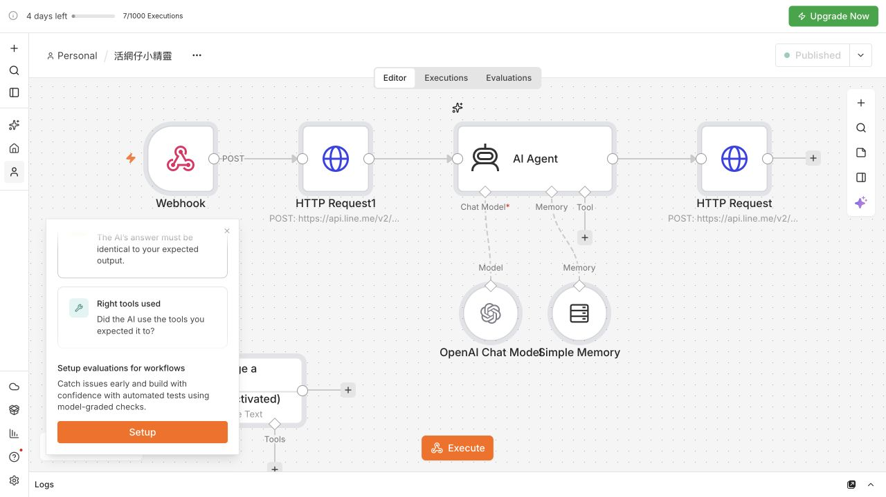

# 活網仔小精靈

死線戰士迷迷餬餬趕出來了 XD

我覺得我現在還不夠徹底了解課程的東西，所以這次想先做一個輕鬆的小東西，就是聊天工具。

它叫「活網仔小精靈」。我是一個什麼東西都看的人，不管是娛樂性的、知識性的，看到冷知識、冷笑話或一些爛梗，都會覺得蠻有趣的。所以想說，無聊的時候可不可以丟一句話給它，就有個東西像姐妹一樣跟我亂聊一下。

另外就是 AI 短劇。我比較喜歡看 AI 的，今天可能想看復仇戲，明天又想看無限流，希望它可以幫我查，一次推薦一部、直接給連結，我就可以自己點開看看。

## 先讓它回得出來，再來看它到底回了什麼

上面這張就是我目前的工作流。主線從左邊開始，是 Webhook → HTTP Request1 → AI Agent → HTTP Request。AI 底下還有 OpenAI Chat Model 和 Simple Memory；左下角停用的 Message a model，是跟課程做到前一階段留下的，現在沒有接在主線裡。

我從 LINE 官方帳號傳訊息，LINE 就把資料送進最左邊的 Webhook。這裡用的是 POST，除了收到我打的那句話，也會收到 userId 和這次回覆要用的 replyToken。

旁邊第一個 HTTP Request1，是先送出 LINE 的等待動畫。因為 AI 有時候會想一下，先讓我知道它有在處理，不然真的會以為它又沒反應了。這個節點呼叫 LINE 的 loading/start，chatId 用收到的 userId。

中間的 AI Agent 才是負責回話的地方。User Message 接的是 Webhook 裡的 body.events[0].message.text，也就是我這次傳的文字；System Message 則放我希望它做什麼、怎麼講話。模型用 OpenAI Chat Model 的 GPT-5-mini，找劇時另加 Web Search。搜尋工具是在模型裡設定的，圖上沒有另外拉一顆搜尋節點。

底下的 Simple Memory 用 userId 當 Key，記憶長度設 10。這樣我換一句話，它才有前面的聊天內容可以參考。課程版有先測過，跟它說名字和喜好，再問一次，它有記得。

最後那顆 HTTP Request，才是把 AI 的答案送回 LINE。它用 POST 呼叫 LINE 的 /v2/bot/message/reply，把 Webhook 的 replyToken 和 AI Agent 的 output 一起送回去。我後來才比較理解，前面那包是「LINE 傳給我什麼」，最後這包才是「我要回 LINE 什麼」。

正式用的時候，還要把流程 Publish，LINE Developers 裡也要換成 Production URL。測試網址要先按聆聽，不能一直拿它當正式網址聊。

## 本來只是想要個姐妹，先得到一個很熱情的小花

課程版叫小花，會用很多 Emoji，有時候還會寫詩。我有收到回覆，也確認它有記憶了，但回話就覺得蠻生硬的。

所以後來改成我自己的版本：繁體中文、短一點、像姐妹聊天。可以有點吐槽、無厘頭，有點已讀亂回的感覺，但要有接到我在講什麼。不要每次自我介紹，也不用一直問我要不要更多。

現在主要想玩三件事：冷笑話、諧音梗／爛梗、AI 短劇推薦。冷知識也有保留，我有問再給一則就好。指令裡有特別寫，一次給一個笑話或一個梗；推薦短劇也只給一部，不要一次丟一大串。

實際聊起來是這樣，這裡把姓名和帳號稱呼拿掉了：

我：講一個冷笑話
它：為什麼數學書很憂鬱？
因為它有太多問題。

我：拿珍珠奶茶接一個諧音爛梗
它：珍珠奶茶？「真煮奶茶」，喝了才知道是不是真心煮的。

接著我換了一個內容：

我：我想看復仇題材的 AI 短劇，或者現在熱門的。
它：推薦《拳拳AI意》，並附上紅果詳情連結。

結果這一個沒有做對。點進官方頁面看，裡面有列真人演員，它只是故事裡有角色偽裝成 AI，不是我想找的「AI 做的短劇」。

所以有回覆、有連結，還是不能直接說成功了。這邊後來又改了指令：要從官方 AI 劇分類或 AI 劇榜確認，不能因為劇名有 AI 就推給我，也明確排除剛剛那部真人劇。查不到就說查不到，不要亂補劇情或網址。

這個修正版已經發布，但還沒從 LINE 重測；換成無限流的測試也還沒做。所以目前能確認的是冷笑話、諧音梗有回出來，找劇還在調。

## 節點分開拉得出來，接起來又是另一件事

這真的是我做的時候最煩躁的地方。那些節點我分別都拉得出來，但把它串起來，就會想說為什麼東西又跑不動。尤其已經很累的時候，就會更煩躁。

這次有卡在回覆節點。原本 Webhook 直接接 HTTP Request 的時候，後面可以直接拿前面的資料；中間放了 AI 之後，前一顆就不是 Webhook 了。replyToken 得改成明確引用 Webhook，回答文字則接 AI Agent 的 output，不能繼續沿用鸚鵡回聲版的欄位。

AI 的回答如果有換行，也會影響 JSON，所以回傳文字用了 JSON.stringify($json.output)。另外還有一次回覆公式混進舊內容，LINE 就沒回，後來清掉重填，再傳新訊息測。

對我來說，這次比較有感的是：有把線接上，跟資料真的接對，原來還是兩件事。然後接得動之後，還要再看它的回答到底是不是我要的，像這次 AI 短劇就又是一個例子。

## 聊完以後，我其實更想把東西整理起來

因為我就是一個什麼東西都看的人，娛樂性的、知識性的內容都會看，所以之後很希望可以做到清楚的整理，而不是看完就不知道放哪裡了。

在板上有看到有人做 Notion 的整理，但我自己更常用 Google 家的工具，所以會想往 Google 的工具去做。把看到的連結、主題和重點整理起來，以後比較找得到。要用 Google Sheets、Google Docs，還是搭配 Drive，我想等自己更懂一點再決定。

另外也看到有人用 Apps Script，覺得蠻感興趣的，之後會想試試看。這次就先從這隻可以亂聊一下的小精靈開始，慢慢把課程裡那些東西接起來。

---

[流程圖與作品紀錄](https://github.com/Immataipeithing/active-net-line-sprite)

公開的是流程截圖和說明，沒有放 LINE 權杖、API 金鑰或對話個資。這個作品庫不含可直接匯入的 n8n 工作流程檔。

